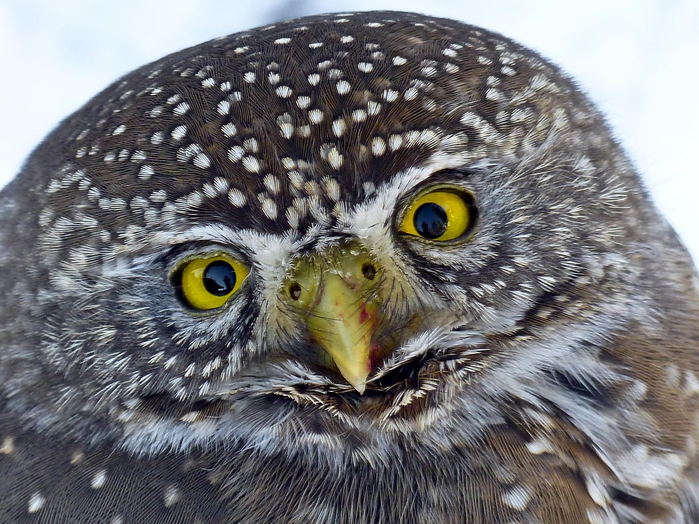
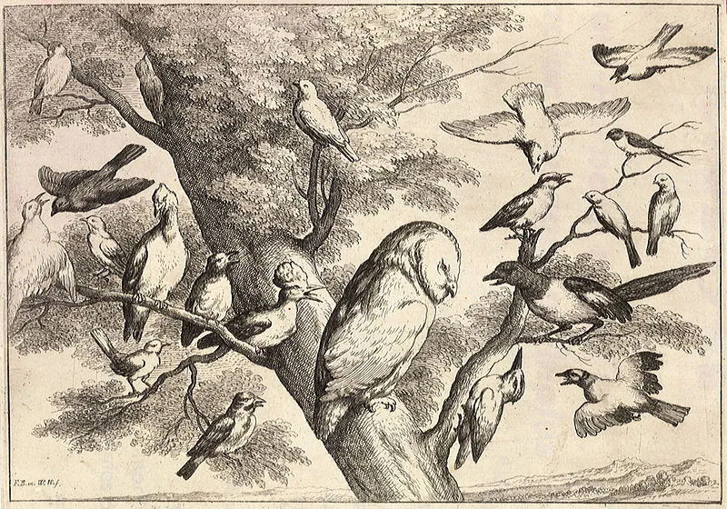
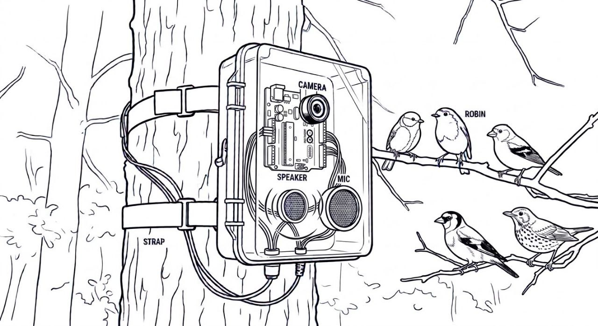
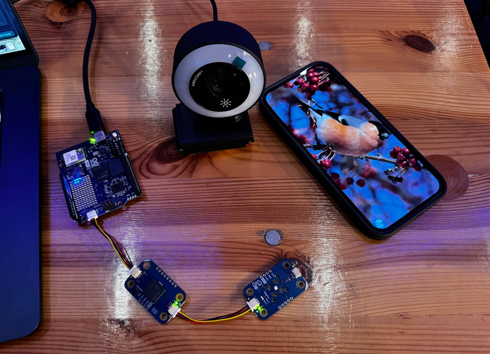
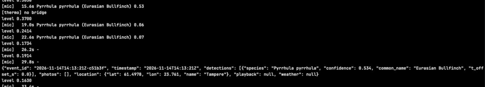
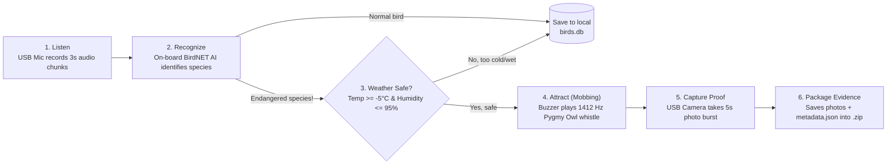

# Pygmy

**Edge-AI forest node that whistles to attract endangered birds into camera range to generate conservation proof and protect forests**  
*named after Pygmy owls*

<p align="center">
  
</p>

We're developing an edge-AI node using Arduino Q to protect endangered bird species and stop harmful forest cutting.

In Finland (and probably in the rest of Europe as well) every tree cutting must be studied and granted permission separately.
One of the fears is disturbance of the ecosystem and inhabitation of the forest. Such as birds. Many endangered and especially important species of birds are already marked by volunteers and ecologists.

However, there is still a percentage of unmarked birds. How do we find them more efficiently and affordably?

Well, sending professionals to watch the area and report any unmarked birds they find is one way, but that requires a lot of time, effort and money.

We're developing a solution that uses edge-AI to detect and report unmarked birds automatically, without the need for human intervention.
Using low-power edge-AI nodes that attract, take pictures and even recognize the bird species based on the bird calls that they make. All using "on-board" AI on Arduino Q, there is no need for a datacenter to process the data, all happens on a single board.

Now let's get into details...

---

### So how are we doing that?

Many smaller species of birds have this instinct called **"Mobbing"**.
Mobbing is when smaller birds swoop, call loudly, and gang up on a bigger bird (or other threat) to drive it away.

<p align="center">
  <br>
  <em>Birds mobbing an owl. Etching by Wenceslaus Hollar from 1600s</em>
</p>

This instinct creates an interesting phenomenon. Birds would engage in mobbing only if they hear bird calls coming from a larger bird or threat.
One of the threats in Northern Europe is the Pygmy owl or *Glaucidium passerinum*.

You can read more about it here:
> Dutour, M., Léna, J.-P., & Lengagne, T. (2016) — *Animal Behaviour*, 119, 119–124.  
> "Mobbing behaviour varies according to predator dangerousness and occurrence"  
> https://sde.hal.science/hal-01386660

What makes Pygmy owls especially interesting is that their bird sound is quite simple and can be effectively reproduced even by a human.
You can check out recordings here: https://xeno-canto.org/species/Glaucidium-passerinum

From this paper we can learn the exact hooting or bird sound frequencies and patterns:
> Galeotti, P., Paladin, M., & Pavan, G. (1993) — *Ornis Scandinavica*, 24, 15–20.  
> "Individually distinct hooting in male Pygmy Owls *Glaucidium passerinum*: a multivariate approach"  
> https://www.jstor.org/stable/3676404

Quote from this paper:
> **"Typically, the hooting of Pygmy Owls is composed of a single note which lasts 0.25 ± 0.02 s, repeated monotonously at 5-10 units per 10 s; the mean fundamental frequency is 1412 ± 68 Hz and the interval between hootings is 1.79 ± 0.17 s"**

Okay, so now we know how to attract the birds by mimicking the hooting pattern of a Pygmy owl.

---

<p align="center">
  <br>
  <em>(don't take it too seriously, just an illustration generated by Google Gemini)</em>
</p>

---

We are using a microphone to detect the bird calls from endangered species, once we detect a bird call from a species that we are interested in we play a sound to attract the birds and take pictures.
This way we can gather a real proof that the birds are living in the area and the trees cannot be cut down for example.

The device is taking a burst of images together with metadata (location, timestamp, bird species, is it endangered or not etc.) and saves it into zip files.

---

### How can we recognize a bird call from a species that we are interested in?

We are using a pre-trained open-source model — **BirdNET** to recognize bird calls from the microphone input.  
More about it here: https://birdnet.cornell.edu/

It is a really small and efficient model that can be easily deployed on a device like Arduino Q and it can recognize up to 11 000 bird species.

---

### A little bit about bird disturbance that can be caused by our device:

When a bird hears a predator, it will certainly be stressed. That's why we are not going to play the owl's hooting constantly, only with really long delays or/and only when we detect a bird call from a species that we are interested in, then we play a sound to attract the bird closer to a camera to take a picture.

Also we are using a thermal sensor to sense temperature and humidity. So we won't be disturbing the birds in really hot or cold weather.

---

### Proof that it actually works

<p align="center">
  
</p>

We played sounds of a bullfinch and it was able to catch that, identify correctly and record pictures with metadata:

<p align="center">
  
</p>

Yea, we know our product isn't the prettiest, but we believe in the idea and our prototype was able to demonstrate that it's able to work.

---

### About limitations and what could be improved in the future

We only had a buzzer available, so we found out the exact frequency of the Pygmy owl voice; with an actual speaker it would be much cleaner.
Secondly, the "non-sterile" noisy environment at the Junction venue made it very difficult to test our product properly, as it would require a relatively silent environment. Nevertheless, we had a couple of successful runs.

---

Of course, our product is in a prototype stage and these things can be improved in the future, nevertheless we're trying to incorporate sustainable and ethical features from day one.

Thanks!

**Connect with us if you want to know more or connect:**
- [www.linkedin.com/in/pavel-kudelko](https://www.linkedin.com/in/pavel-kudelko)
- [www.linkedin.com/in/nikolai-shchukin](https://www.linkedin.com/in/nikolai-shchukin)

---

## How It Works (Simple Overview)



## Project Structure

```text
├── app.yaml
├── media/
│   ├── pygmy_owl_closeup.jpg
│   ├── image.png
│   ├── image_1.png
│   ├── prototype_setup.jpg
│   └── bullfinch_log.png
├── sketch/
│   ├── sketch.ino
│   └── sketch.yaml
├── python/
│   └── main.py
├── bird_recognition/
│   ├── audio.py
│   ├── bundle.py
│   ├── events.py
│   ├── main.py
│   ├── models.py
│   ├── pipeline.py
│   ├── store.py
│   └── vision.py
├── sync-to-board.sh      # Push local git repo changes to the connected UNO Q
└── sync-from-board.sh    # Pull changes made in Arduino App Lab back to local git repo
```
