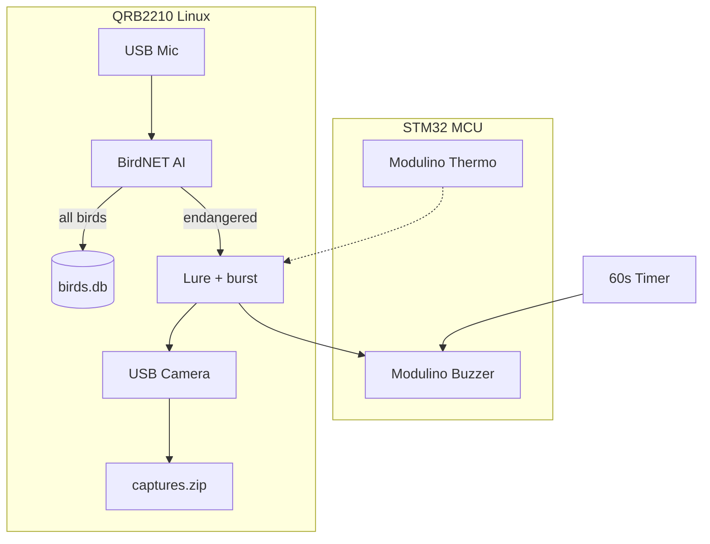

# Pygmy

## Architecture



## Project Structure

```text
├── app.yaml
├── sketch/
│   ├── sketch.ino
│   └── sketch.yaml
├── python/
│   └── main.py
├── sync-to-board.sh      # Push local git repo changes to the connected UNO Q
└── sync-from-board.sh    # Pull changes made in Arduino App Lab back to local git repo
```

##  Workflow

1. **Pull latest changes from GitHub:**
   ```bash
   git pull
   ```
2. **Push code from your laptop to the connected Arduino UNO Q:**
   ```bash
   ./sync-to-board.sh
   ```
3. **If you edited code inside the Arduino App Lab GUI, pull it back before committing:**
   ```bash
   ./sync-from-board.sh
   git add -A && git commit -m "Update" && git push
   ```